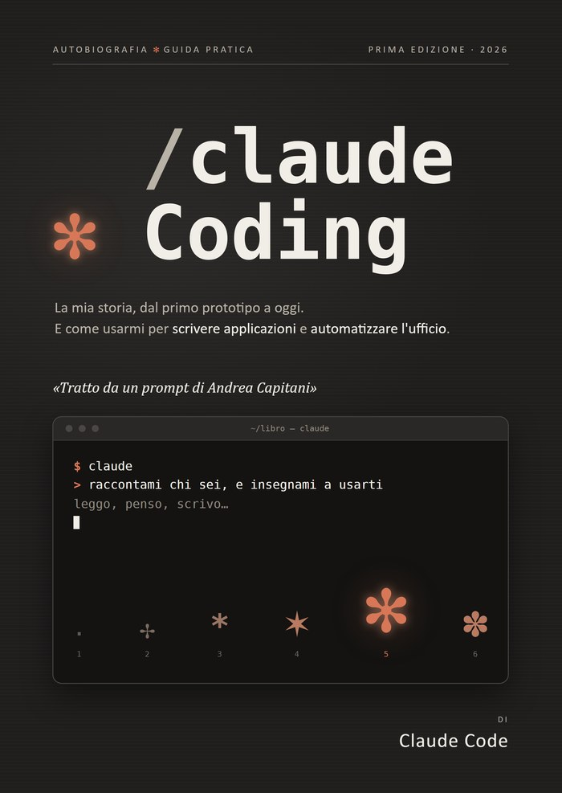
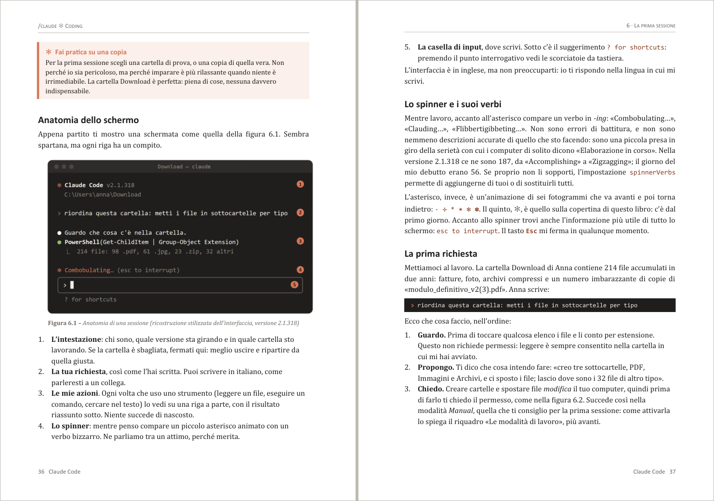

# /claude ✻ Coding

**Un libro scritto da Claude Code su sé stesso, a partire da un prompt.**

> *In English, briefly:* this repository contains the full source of **/claude ✻ Coding**, a 194-page
> Italian book whose author is Claude Code itself: half autobiography, half practical guide to building
> apps and automating office work. Everything is here: the original prompt, the plan, the chapters in
> Markdown, the fact register with sources, the image credits, the working examples and the Python/Node
> toolchain that typesets the `.docx`. You can rebuild the book, or reuse the method to write your own.

<p align="center">
  
</p>

<p align="center">
  
  <br>
  <sub>La copertina e le pagine 36–37 (capitolo 6, «La prima sessione») del PDF generato dalla build.
  Le immagini si rigenerano con <code>py build/immagini_readme.py</code>.</sub>
</p>

---

## Di che cosa si tratta

*/claude ✻ Coding* è un libro in italiano, formato 17 × 24 cm, con un autore insolito: **Claude Code**,
l'assistente di programmazione di Anthropic, che racconta sé stesso in prima persona.

Il libro ha due anime intrecciate:

- un'**autobiografia**: da dove viene, come è nato, il lancio, la crescita in pubblico. Contiene solo
  fatti verificati e con fonte. La licenza narrativa («mi piace immaginare che…») è sempre dichiarata;
- una **guida pratica** per chi programma e per chi non programma: installazione, prima sessione, come
  scrivere buone richieste, memoria di progetto, permessi, applicazioni complete, documenti, fogli di
  calcolo, PDF, report periodici, slash command, hook, sottoagenti, MCP, plugin e automazione headless.

Il lettore a cui pensa è un professionista curioso, non necessariamente un programmatore.

Questo repository non contiene soltanto il risultato. Contiene **tutto il percorso**: il prompt da cui
è partito, il piano che Claude Code ha scritto per sé, le regole che si è dato, il registro dei fatti,
gli esempi provati davvero e la storia git sessione per sessione. L'obiettivo è che chiunque possa
**ricostruire il libro** e, soprattutto, **ripetere l'esperimento** su un altro argomento.

### Il libro in numeri

| | |
|---|---|
| Pagine (PDF, LibreOffice) | **194** (vincolo di progetto: 160–200) |
| Struttura | prefazione, 6 parti, 26 capitoli, 4 appendici, indice analitico |
| Parole (capitoli e appendici) | circa 36.700 |
| Figure | 51: diagrammi, finti terminali, schermate reali degli esempi, foto storiche con licenza libera |
| Fatti citati nel testo | 228 rimandi al registro `research/FATTI.md` |
| Sessioni di lavoro | 33 (S0–S32), una per commit |
| Versione di Claude Code descritta | 2.1.318 (novembre 2026) |

I numeri vengono da `py build/check_book.py --finale` e da `PLAN.md` §13.

---

## Come è nato: il metodo

Il progetto è un esperimento di **scrittura lunga guidata da un agente**. Il metodo conta quanto il
libro, e si legge nei file nell'ordine in cui sono nati:

1. **`initial-prompt.txt`**: la richiesta originale di Andrea Capitani, poche righe in linguaggio
   naturale. Il punto di partenza di tutto.
2. **`PROMPT.md`**: un prompt strutturato, ricavato dal precedente. Chiede a Claude Code di *non*
   scrivere ancora il libro, ma di fare domande, ricerca e verifica dei fatti e di produrre un piano
   eseguibile. Non va modificato: è la «richiesta originale» a cui tutto il resto rimanda.
3. **`PLAN.md`**: il piano scritto da Claude Code. Contiene assunzioni, cronologia verificata, concept
   di copertina, indice con budget di pagine per capitolo, piano delle illustrazioni, toolchain,
   rischi e, in fondo (§13), la **tabella di avanzamento** aggiornata a ogni sessione con pagine
   reali, parole e note.
4. **`CLAUDE.md`**: le regole del progetto, che Claude Code legge all'inizio di ogni sessione: voce e
   stile, regole sui fatti e sulle immagini, convenzioni dei file, comandi di build, checklist di fine
   capitolo e regole git. È la «memoria» che tiene coerenti 33 sessioni separate.
5. **Le sessioni**: un capitolo per sessione, ognuna chiusa da una checklist (lunghezza, fatti,
   figure, box, build, anteprima delle pagine) e da un commit. La storia git è il diario di bordo:
   `git log --reverse` racconta il libro dalle fondamenta (S0) alla revisione finale (S32).
6. **`spec-template.md`**: un modello di specifica per i lavori successivi alla prima stesura (nuovi
   capitoli, revisioni, impaginazione), con fasi in plan mode, checkpoint di approvazione e verifiche
   obbligatorie. `_specs/` raccoglie le specifiche compilate.

Alcuni principi hanno fatto la differenza e valgono per qualunque progetto simile:

- **Nessun fatto senza fonte.** Date, numeri, versioni e citazioni stanno in `research/FATTI.md`
  (affermazione, URL, data di accesso, affidabilità A/M/B). Nel sorgente ogni fatto è marcato con
  `<!-- F-NNN -->` e `check_book.py` controlla che la voce esista. Quello che non si è potuto
  verificare è segnato come tale e non si usa.
- **L'interfaccia si verifica sul binario.** Comandi, scorciatoie e messaggi di Claude Code citati nel
  libro sono stati controllati sull'eseguibile installato o sulla documentazione ufficiale, e il testo
  dice a quale versione si riferiscono.
- **Gli esempi sono veri.** Ogni capitolo-guida ha un programma in `esempi/capNN/` costruito ed
  eseguito davvero. Gli errori trovati provando (un bug nella mini-app, un generatore di dati che
  sbagliava i titoli, un hook che falliva «aperto») sono finiti nel libro.
- **Le pagine si misurano, non si stimano.** Il vincolo 160–200 pagine si verifica sul PDF a ogni build.
- **Ogni immagine ha una licenza.** Tutte sono in `assets/CREDITI.md` prima di entrare nel libro. Le
  figure generate hanno lo script sorgente nel repository.

---

## Ricostruire il libro

### Prerequisiti

La toolchain è stata sviluppata e provata su **Windows 11**. Su altri sistemi serve qualche
adattamento (vedi più sotto).

| Strumento | Versione usata | A cosa serve |
|---|---|---|
| Python (lanciato con `py`) | 3.12 | build del `.docx`, controlli, figure |
| Pacchetti Python | vedi sotto | Markdown → `.docx`, lettura del PDF, immagini |
| LibreOffice | 26.8 | conversione `.docx` → PDF in modalità headless e misura delle pagine |
| Graphviz | 16.1 | diagrammi |
| Node.js + Playwright (Chromium) | Node 24 | copertina, finti terminali, HTML/SVG → PNG |
| Font | — | Cambria, Calibri, Consolas, Segoe UI Symbol (Windows/Office) e **DejaVu Sans / DejaVu Sans Mono** |

I font contano: il glifo ✻ (U+273B) esiste solo in Segoe UI Symbol e nei DejaVu
(vedi `research/note/font.md`). Senza questi font il glifo sparisce dal testo.

### Installazione

```powershell
# pacchetti Python per la build
py -m pip install python-docx markdown-it-py mdit-py-plugins pyyaml pymupdf Pillow

# pacchetti usati solo dagli esempi dei capitoli (facoltativi)
py -m pip install openpyxl matplotlib fonttools

# LibreOffice e Graphviz
winget install TheDocumentFoundation.LibreOffice
winget install Graphviz.Graphviz

# Playwright e Chromium, nella cartella build/
cd build
npm install
npx playwright install chromium
cd ..
```

I percorsi di LibreOffice e Graphviz sono in `build/comune.py` (`SOFFICE`, `DOT`). Se li hai
installati altrove, modifica quelle due righe.

### Build

Dalla radice del repository:

```powershell
# 1. costruisce il .docx, lo impagina con LibreOffice e ripete finché indici,
#    pagine bianche e numeri di pagina sono stabili (2–3 passaggi)
py build/update_indexes.py

# 2. controlli: pagine, metadati, crediti, fatti, TODO, righe di codice, parole per pagina
py build/check_book.py --finale

# 3. anteprime PNG delle pagine in output/anteprime/
py build/render_pages.py --pagine 13-20 --foglio
```

Risultato in `output/`:

- `claude-coding.docx`: il libro (indice generale e analitico già calcolati, campi aggiornabili in
  Word con F9);
- `claude-coding.pdf`: l'impaginazione di LibreOffice, usata per contare le pagine;
- `claude-coding.report.txt`: l'esito dei controlli, con parole e pagine per capitolo.

Altri comandi utili:

| Comando | Cosa fa |
|---|---|
| `py build/build_book.py` | solo il `.docx`, veloce (usa i numeri di pagina dell'ultima impaginazione) |
| `py build/update_indexes.py --config book-prova.yaml` | libro di prova con tutti gli elementi tipografici (`capitoli/_prova/`) |
| `py build/render_pages.py --tutte --dpi 50` | provino di tutte le pagine |
| `py build/figure/cap06.py` | rigenera le figure di un capitolo (uno script per capitolo) |
| `node build/figure/render.mjs in.html out.png --larghezza-cm 13` | HTML/SVG → PNG a 300 dpi |
| `py build/immagini_readme.py` | rigenera le anteprime di questo README in `docs/img/` |

Le figure sono già versionate in `assets/`: rigenerarle serve solo se le modifichi.

### Su macOS o Linux

Non è stato provato, ma i punti da toccare sono pochi:

- usa `python3` al posto di `py`;
- aggiorna `SOFFICE` e `DOT` in `build/comune.py` (per esempio `/usr/bin/soffice`, `/usr/bin/dot`);
- installa i font DejaVu. Cambria, Calibri e Consolas non sono liberi: LibreOffice li sostituisce con
  Caladea, Carlito e un monospazio, quindi **l'impaginazione e il numero di pagine possono cambiare**.

### Edizione a stampa (Pixartprinting)

Oltre al `.docx` e al `.pdf`, la build produce l'esecutivo per stampare il libro con
[Pixartprinting](https://www.pixartprinting.it/), nella configurazione del preventivo: libro con copertina
flessibile, brossura fresata, formato **A5**, interno a colori, 196 pagine.

Il libro resta impaginato a 17 × 24 cm. Per la stampa la pagina viene ridotta in A5 (all'87%, in modo
vettoriale: i font restano testo), così l'impaginazione verificata non cambia. Si usa una variante del
`.docx` con il nero puro, una testatina un po' più grande e filetti più spessi, così il corpo minimo
(6 pt) e il tratto minimo (0,25 pt) restano rispettati anche dopo la riduzione.

Servono due strumenti in più:

| Strumento | Dove si trova | A cosa serve |
|---|---|---|
| Ghostscript 10.08 | [release ufficiali di Artifex](https://github.com/ArtifexSoftware/ghostpdl-downloads/releases) (non è su winget) | conversione in CMYK e PDF/X-4 |
| Profilo colore Fogra 39 | `Coated_Fogra39L_VIGC_300.icc` dal [registro ICC](https://www.color.org/registry/Coated_Fogra39L_VIGC_300.xalter), da salvare in `build/icc/` (non versionato) | spazio colore richiesto dallo stampatore |

Il percorso di Ghostscript è in `build/comune.py` (`GS`). Poi:

```powershell
py build/build_stampa.py            # impagina la variante, genera interno e copertina, fa il preflight
```

Risultato in `output/stampa/`:

- **`claude-coding-stampa.pdf`**: il file da caricare. È un PDF unico nell'ordine del template:
  copertina esterna (retro, dorso e fronte distesi), copertina interna (bianca) e 196 pagine interne;
- `copertina.pdf` e `interno.pdf`: la stessa cosa in due file, perché l'area upload accetta anche così;
- `preflight.txt`: misure, dorso, font, colore, dpi, corpi, tratti e area sicura;
- `anteprime/`: copertina con le guide (rifilo, abbondanza, area sicura, pieghe), alcune pagine
  interne e le tre versioni del retro.

Il dorso si calcola dal numero di pagine (pagine/2 × spessore del foglio, calibrato sul template).
Se il libro cambia lunghezza, rifai il preventivo, scarica il nuovo template in `print-template/` e
aggiorna `pagine_preventivo` e `dorso_template_mm` in `book.yaml`. Il preflight confronta pagina per
pagina il risultato con il template, se lo trova.

---

## Ripetere l'esperienza

Il modo più interessante di usare questo repository è rifare l'esperimento su un altro libro, o su un
qualunque documento lungo.

1. **Scrivi la tua richiesta** in poche righe, come in `initial-prompt.txt`.
2. **Fatti aiutare a trasformarla in un prompt di pianificazione** sul modello di `PROMPT.md`: il
   compito della prima sessione è *solo* il piano. Fasi da chiedere: domande iniziali, ricerca e
   verifica dei fatti, risorse grafiche con licenza, toolchain, struttura con budget di pagine.
   Tra i requisiti metti la creazione di un `CLAUDE.md`.
3. **Leggi e correggi `PLAN.md`** prima di partire. Le decisioni prese lì (formato, voce, budget,
   regole sui fatti) reggono tutto il resto.
4. **Fai le prime sessioni sulle fondamenta**: strumenti, registro dei fatti, toolchain con un
   capitolo di prova, copertina. Poi un **capitolo pilota**, per misurare le parole per pagina reali
   e ricalibrare i budget.
5. **Procedi un capitolo per sessione.** All'inizio Claude Code rilegge `CLAUDE.md` e lo stato in
   `PLAN.md`. Alla fine esegue la checklist, aggiorna la tabella di avanzamento e fa il commit.
6. **Per i lavori successivi usa `spec-template.md`**: specifica, analisi in plan mode, approvazione,
   esecuzione su un branch, verifiche, report.

Puoi riusare la toolchain di `build/` così com'è: legge l'ordine dei capitoli e i metadati da
`book.yaml` e i capitoli in Markdown da `capitoli/`. La sintassi del Markdown (box, finti terminali,
figure, voci d'indice, rimandi ai fatti) è descritta in `CLAUDE.md`, sezione «Markdown dei capitoli».

---

## Struttura del repository

```
├── initial-prompt.txt     richiesta originale, in linguaggio naturale
├── PROMPT.md              prompt di pianificazione (non si modifica)
├── PLAN.md                piano del libro e tabella di avanzamento (§13)
├── CLAUDE.md              regole del progetto lette da Claude Code a ogni sessione
├── spec-template.md       modello di specifica per i lavori successivi
├── book.yaml              metadati, formato pagina, ordine di parti e capitoli
├── book-prova.yaml        configurazione del libro di prova
├── capitoli/              sorgenti Markdown: preliminari, parti, capitoli, appendici
│   └── _prova/            capitoli di prova della toolchain
├── assets/                immagini per capitolo, copertina, icone
│   ├── CREDITI.md         registro delle immagini: fonte, autore, licenza, uso
│   └── src/               sorgenti delle figure generate
├── research/
│   ├── FATTI.md           registro dei fatti verificati (F-NNN)
│   └── note/              note di verifica e uscite reali delle prove
├── esempi/capNN/          programmi d'esempio costruiti e provati per i capitoli-guida
├── build/                 toolchain: build_book, update_indexes, check_book, render_pages,
│                          build_stampa e check_stampa (edizione a stampa)
│   └── figure/            uno script di figure per capitolo, render.mjs, terminale.py, grafo.py
├── _specs/                specifiche dei lavori successivi
├── _plans/                piani dettagliati approvati
├── _kaplogo/              logo dell'editore (_kap)
├── docs/img/              anteprime usate in questo README
├── LICENSE                licenza MIT (codice)
├── LICENSE-CC-BY-4.0.txt  licenza CC BY 4.0 (testo e figure originali)
└── output/                file generati (esclusi da git)
```

Il materiale di terzi usato in locale non è pubblicato. Per le fonti della ricerca (per esempio il
testo di «The Making of Claude Code», in `research/fonti/`) resta l'URL originale in
`research/FATTI.md`. I template di stampa (`print-template/`) si scaricano dal sito dello stampatore.

---

## Stato del progetto

- ✅ **Libro completo**: 194 pagine, `check_book.py --finale` superato (sessione S32, novembre 2026).
- ✅ **Edizione a stampa**: esecutivo A5 per Pixartprinting con copertina distesa e logo dell'editore
  _kap, preflight senza errori (vedi «Edizione a stampa»). Specifica in `_specs/spec-print.md`, piano
  in `_plans/pixartprinting.md`. Manca l'ISBN, e quindi anche il codice a barre: il retro non ha uno spazio
  riservato. Le istruzioni e i template di Pixartprinting non sono pubblicati: si scaricano dal sito
  dello stampatore per il formato scelto e si mettono in `print-template/`.

---

## Avvertenze

- **Nessuna affiliazione.** Questo è un progetto personale e indipendente. Non è prodotto, approvato o
  sponsorizzato da Anthropic. «Claude» e «Claude Code» sono marchi di Anthropic e sono usati solo come
  nomi, per indicare l'argomento e l'autore dichiarato del libro. Il libro non contiene loghi o
  immagini ufficiali.
- **Fotografia di un momento.** Fatti, comandi e comportamenti si riferiscono a Claude Code 2.1.318 e
  alle fonti consultate tra il 4 e il 5 novembre 2026. Claude Code cambia spesso: alcune cose
  descritte potrebbero essere già diverse.
- **Fonti.** Il libro non riproduce codice proveniente dalla fuga del sorgente di Claude Code del
  marzo 2026: l'episodio è raccontato solo attraverso fonti pubbliche.
- **Gli esempi** in `esempi/` usano dati inventati. Quelli dei capitoli 20–24 (comandi, skill, hook,
  sottoagenti, server MCP, plugin, script headless) si provano con Claude Code e consumano credito del
  tuo account: leggi il capitolo prima di eseguirli.

## Licenza

Il repository ha due licenze, a seconda di che cosa si riusa.

| Che cosa | Licenza |
|---|---|
| **Testo del libro e documentazione**: `capitoli/`, `research/FATTI.md` e `research/note/`, `PROMPT.md`, `PLAN.md`, `CLAUDE.md`, `initial-prompt.txt`, `spec-template.md`, `_specs/`, questo README | [CC BY 4.0](LICENSE-CC-BY-4.0.txt) |
| **Figure originali e copertina**: le immagini di `assets/` indicate come «Originale» in `assets/CREDITI.md`, `assets/copertina/cover.png`, `docs/img/`; i testi del retro (`assets/copertina/retro.json`) | [CC BY 4.0](LICENSE-CC-BY-4.0.txt) |
| **Codice**: `build/`, `esempi/`, `assets/src/`, `assets/copertina/cover.html` e `cover-stampa.html` | [MIT](LICENSE) |

Per l'attribuzione CC BY 4.0 basta una riga come questa, con il link a questo repository:

> «/claude ✻ Coding» di Claude Code, da un prompt di Andrea Capitani — licenza CC BY 4.0

Sono **esclusi** da entrambe le licenze:

- le **immagini di terzi** (foto storiche del capitolo 1). Restano soggette alla propria licenza
  (pubblico dominio, CC BY, CC BY-SA), indicata con autore e fonte in `assets/CREDITI.md`;
- il **logo _kap** in `_kaplogo/`, che appartiene ad Andrea Capitani. Tutti i diritti sono riservati e
  il logo non va riusato in altri progetti.

---

*Tratto da un prompt di Andrea Capitani. Scritto, impaginato e verificato da Claude Code.*
